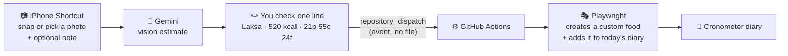

# 📸 Snap to Log

**Take a photo of a meal, and it's in your food diary a minute or two later.**

Logging eat-out meals by hand means guessing every ingredient and searching a food database item by
item. Snap to Log replaces that with one photo: a vision model estimates the calories and macros, you
check one editable line, and GitHub Actions adds it to [Cronometer](https://cronometer.com) as a custom
food in today's diary, without paying for Cronometer's built-in photo logging.

> 🎬 _Demo: snap on the iPhone → confirm the line → the entry appears in the Cronometer diary_ (`docs/demo.gif`)

## How it works



The same pipeline runs from a terminal: `python snap_to_log.py lunch.jpg`.

## Design decisions

| Decision | Why |
| --- | --- |
| **Drive the website with Playwright** | Cronometer has no public API for personal diaries, so a browser is the only way to write an entry. |
| **Event, not a file** | The Shortcut sends a `repository_dispatch` event carrying the meal. Nothing is committed, so no meal lands in this public repo's history, and the workflow never prints it to the (public) run logs. |
| **Custom food, not a note** | A custom food carries real calories and macros, so it counts in Cronometer's own daily totals and charts. |
| **One editable line** (`name \| kcal \| p c f`) | AI estimates are rough. One line is quick to fix with a thumb and easy to validate. |
| **The note overrides the photo** | "Ate half" or "no rice" is information the camera can't see. |
| **Validate before, verify after** | Typos like `5200 kcal` are rejected before the browser opens; success is reported only once exactly one new matching entry shows in today's diary, and nothing is logged if the diary isn't on "Today". |
| **One run at a time** | A concurrency group queues meals sent together, so two logins never collide. |
| **Locators by visible text** | Cronometer's generated ids and class names change between releases; rows and labels don't. |
| **Standard library for AI calls** | Fewer dependencies; Gemini (free tier) or Claude, switched with one setting. |

## Compared with Cronometer Gold

Cronometer added its own [Photo Logging](https://cronometer.com/blog/cronometer-updates-whats-new-improved)
for Gold subscribers in 2025. This project is what I built on the free plan instead, and the trade-offs are real:

| | Snap to Log (free plan) | Gold's Photo Logging |
| --- | --- | --- |
| Cost | Free (Gemini free tier, GitHub Actions) | Gold subscription ([current price](https://cronometer.com/gold/)) |
| Estimate | A general vision model; one total for the meal | Matches from Cronometer's lab-verified food database |
| Nutrients | Calories + protein, carbs, fat | The full nutrient breakdown Cronometer tracks |
| Reliability | Breaks if Cronometer changes its pages; selectors need re-recording | A supported, built-in feature |
| Terms | Automates the website, which the terms may not allow | Official |
| Setup | Shortcut, GitHub repo, secrets | Nothing |
| Side effect | Each meal adds a custom food to your list | None |
| Speed | A minute or two (Actions starts a browser) | Seconds, in the app |

If micronutrients matter or you'd rather not maintain a bot, Gold is the better choice. This shows the
same time saving can be had with automation and a free model.

## Part of a bigger personal system

In my own setup this is one piece of a private pipeline: a scheduled job exports the diary to Google
Sheets every morning, next to sleep, steps and activity from Apple Watch, so the numbers can be analysed
together over weeks rather than one day at a time. That part stays private because it handles personal
health data; this repo is the logging automation on its own.

## Run it yourself

```bash
git clone https://github.com/<you>/snap-to-log && cd snap-to-log
python3 -m venv .venv && source .venv/bin/activate
pip install -r requirements.txt
playwright install chromium
cp .env.example .env          # add an API key + your Cronometer login
```

```bash
python estimate.py lunch.jpg --note "ate half"            # estimate only
python snap_to_log.py lunch.jpg                            # estimate → confirm → log
python cronometer.py "Laksa | 520 kcal | 21p 55c 24f" --show   # log a line, watch the browser
pytest                                                     # parsing and validation tests
```

For the phone → GitHub Actions path, add `CRONO_EMAIL` and `CRONO_PASSWORD` as repository secrets and
build the Shortcut in [shortcut/SHORTCUT.md](shortcut/SHORTCUT.md).

## Project structure

```
snap-to-log/
├── snap_to_log.py            photo → estimate → confirm → log (CLI)
├── estimate.py               vision-model estimate (Gemini or Claude)
├── cronometer.py             Playwright: custom food → today's diary, with checks
├── log_dispatch.py           GitHub Actions entry point for the Shortcut's event
├── meal.py                   the meal line format + validation
├── config.py                 reads .env
├── .github/workflows/
│   ├── log-meal.yml          runs on the Shortcut's "meal" event
│   └── tests.yml             pytest on every pull request
├── shortcut/SHORTCUT.md      how to build the iPhone Shortcut
└── tests/
```

## Limitations

- **Estimates are estimates.** Hidden oil and portion size are the usual misses; the edit step exists for that.
- **Website automation is fragile.** A Cronometer redesign means re-recording the steps with `playwright codegen`.
- **Personal proof of concept.** It automates my own account through the normal website; check Cronometer's
  terms before relying on anything like it.

## Privacy

No credentials are in this repo: the Cronometer login lives in GitHub Secrets (or a git-ignored `.env`
locally), and the API key lives in the Shortcut. Meals travel as events, are never committed, and are
never printed to the public run logs. Photos go only to the AI provider.
